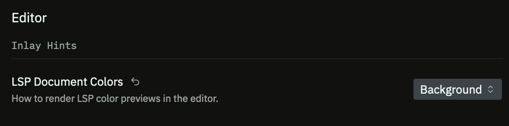
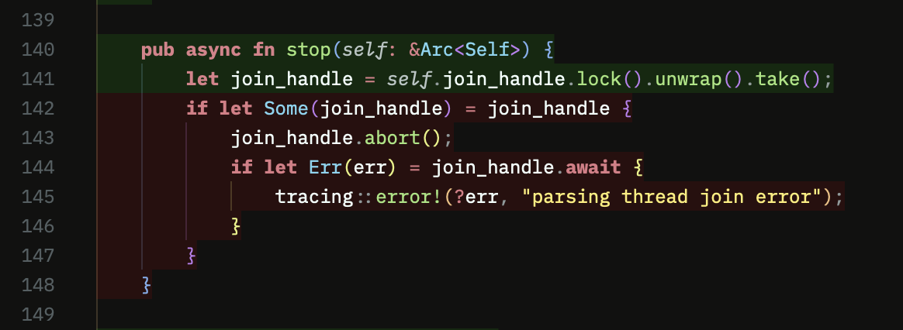
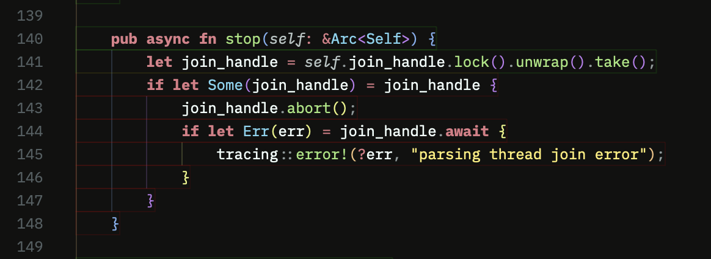
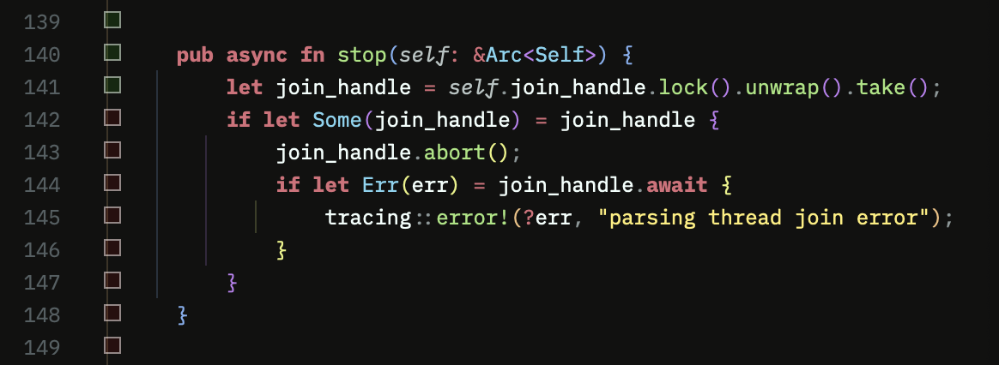

# Code Coverage Language Server

[](https://crates.io/crates/coverage-lsp)
[](https://github.com/fargies/coverage-lsp/actions/workflows/release.yml)
[](LICENSE)

[](https://github.com/sponsors/fargies)
[](https://www.buymeacoffee.com/fargies)

This project implements a Code Coverage
[Language Server](https://microsoft.github.io/language-server-protocol/) that
reads [LCOV](https://lcov.readthedocs.io) coverage reports and exposes the
results through the Language Server Protocol.

Coverage information is surfaced using the
[`textDocument/documentColor`](https://microsoft.github.io/language-server-protocol/specifications/lsp/3.17/specification/#textDocument_documentColor)
request, allowing editors to visually highlight covered and uncovered lines.

It also includes a [Zed](https://zed.dev/) extension that integrates the
language server with Zed.

## Zed-editor extension

### Installation

This extension is available from [Zed extension store](https://zed.dev/extensions/coverage-lsp)
and can be installed directly from the editor.

The extension may also be installed from source, by cloning
[fargies/coverage-lsp](https://github.com/fargies/coverage-lsp) repository and
selecting the `zed-coverage-lsp` directory from "Install Dev Extension" menu.

If not already found in path, the extension will download and install latest
_coverage-lsp_ server from [GitHub's project releases](https://github.com/fargies/coverage-lsp/releases).

To install your own version of _coverage-lsp_, simply use:

```bash
cargo install coverage-lsp
```

### Configuration

The server can be configured through the following settings.

#### `hit`

CSS color used to highlight **covered lines**.

- Accepts any valid [CSS Color Level 4](https://www.w3.org/TR/css-color-4/) value.
- Set to `null` to disable highlighting for covered lines.
- Parsed using [`csscolorparser`](https://crates.io/crates/csscolorparser).
- Default: `rgba(0%,100%,0%,10%)`

#### `miss`

CSS color used to highlight **uncovered lines**.

- Accepts any valid [CSS Color Level 4](https://www.w3.org/TR/css-color-4/) value.
- Set to `null` to disable highlighting for uncovered lines.
- Parsed using [`csscolorparser`](https://crates.io/crates/csscolorparser).
- Default: `rgba(100%,0%,0%,10%)`

#### `lcov_file`

Path to the [LCOV](https://lcov.readthedocs.io) coverage file to load.

- If not specified, the server searches the workspace and uses the first
  `*.info` file it finds.

#### `interval`

Interval used to check whether the coverage file has changed.

- Parsed using [`humantime-serde`](https://crates.io/crates/humantime-serde).
- Example values: `3s`, `20s`, `1m`
- Default: `3s`

#### `dirs_blacklist`

List of directories to ignore when crawling for a coverage file.

- Default: `[ node_modules, deps, incremental, bin, include, lib ]`

#### `ignore_hidden_dirs`

Ignore directories starting with `.` when crawling for a coverage file.

- Default: true

#### `max_depth`

Maximum directory depth during crawl.

- Default: 3

#### `crawl_interval`

Workspace crawling interval used when looking for a file (then `interval` is used).

- Default: 15

#### Example Configuration

```json
{
  "lsp": {
    "coverage-lsp": {
      "settings": {
        "hit": null,
        "miss": "#FFAA0020",
        "interval": "20s",
        "lcov_file": "./build/lcov.info"
      }
    }
  }
}
```

## Look & Feel

How coverage information is displayed in Zed depends on the **LSP Document
Colors** setting:


The language server provides the coverage colors, but the way those colors are
rendered ultimately depends on your Zed theme. Here are some examples of the
different visual styles you can achieve.

Background coloring:


Border coloring:


Inlay coloring:


## Development

```bash
# remove downloaded releases
rm -rf ~/.local/share/zed/extensions/work/coverage-lsp/*
# or on MacOS
rm -rf /Users/fargie_s/Library/Application\ Support/Zed/extensions/work/coverage-lsp/*

# Clone and build this project
git clone https://github.com/fargies/coverage-lsp.git && cd coverage-lsp
cargo build

# Add `coverage-lsp` to your path
export PATH=$PATH:$(pwd)/target/debug

# Start `zeditor`
zeditor

# From the "Install Dev Extension" menu select `zed-coverage-lsp` directory

# Don't forget to "Rebuild" the extension and/or "Restart" the language-server to
# reflect changes
```
